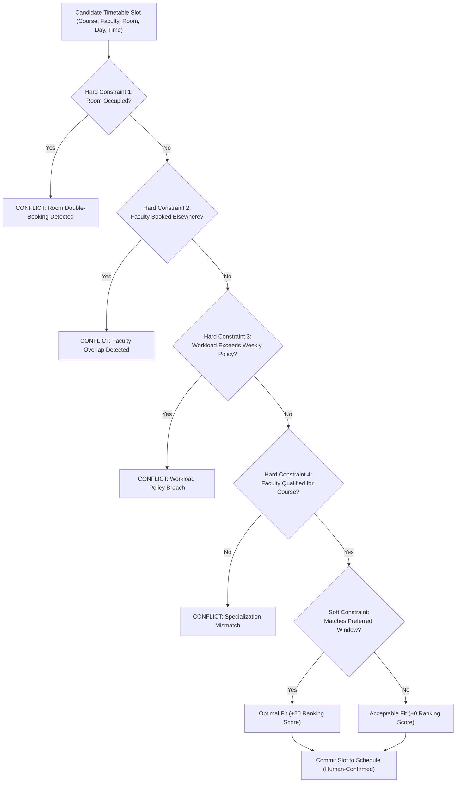
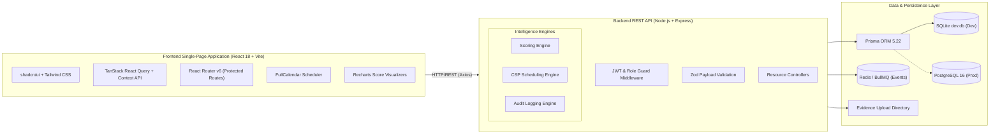

# Faculty Performance Intelligence System (FPIS)

<div align="center">

[](https://react.dev/)
[](https://www.typescriptlang.org/)
[](https://vitejs.dev/)
[](https://tailwindcss.com/)
[](https://nodejs.org/)
[](https://expressjs.com/)
[](https://www.prisma.io/)
[](https://vitest.dev/)
[](#license)

**A centralized, transparent, and explainable academic performance intelligence platform.**  
*Empowering higher education institutions with real-time faculty activity tracking, mathematical contribution scoring, workload compliance monitoring, constraint-based timetable scheduling, and multi-tier approval workflows.*

[Key Features](#-key-features) • [System Architecture](#-system-architecture) • [Scoring & Intelligence](#-explainable-intelligence-models) • [Quickstart Guide](#-quickstart-guide) • [Demo Credentials](#-demo-login-credentials) • [Documentation](#-documentation)

---

</div>

## 📌 Overview

Higher education institutions face significant challenges tracking faculty activities across teaching, mentoring, research, faculty development programs (FDP), committee service, and administrative duties. Traditional approaches rely on disconnected spreadsheets, physical paper trails, and subjective annual reviews that lack auditability and transparency.

The **Faculty Performance Intelligence System (FPIS)** replaces legacy, fragmented workflows with an institution-wide full-stack platform. FPIS provides:
- **Zero Black-Box Evaluations:** Every performance score is derived from verified evidence and auditable mathematical formulas.
- **Role-Based Workflows:** Distinct, customized workspaces for **Faculty**, **Reviewers / Department Heads (HODs)**, and **Academic Administrators**.
- **Conflict-Free Timetabling:** A multi-pass Constraint Satisfaction Problem (CSP) solver that prevents room clashes, instructor overlaps, and workload violations.
- **Accreditation Readiness:** One-click CSV and analytical reporting built to streamline NBA, NAAC, and NIRF institutional evaluations.

---

## 🔑 Key Features

### 👨‍🏫 1. Faculty Workspace & Activity Management
* **Comprehensive Activity Tracking:** Full lifecycle CRUD across 7 standard academic categories:
  1. Teaching Workload (Theory & Laboratory)
  2. Faculty Development Programs (FDP / STTP / Workshops)
  3. Student Mentoring & Counseling
  4. Extra Remedial & Tutorial Sessions
  5. Departmental & Institutional Committee Service
  6. Administrative Responsibilities (e.g., Exam Cell, Accreditation Coordinator)
  7. Extracurricular & Community Outreach
* **Digital Evidence Attachment:** Secure document upload (PDF, PNG, JPG up to 10 MB) supporting every submission.
* **Real-Time Workload & Score Feedback:** Interactive dashboards visualizing approved teaching hours vs. institutional caps and qualitative performance tier distribution.

### 🔍 2. Reviewer / HOD Verification Queue
* **Strict Departmental Isolation:** Reviewers only inspect submissions originating from faculty within their jurisdiction.
* **Transparent Multi-State Workflow:** Complete state machine:
  $$\text{DRAFT} \longrightarrow \text{SUBMITTED} \longrightarrow \text{UNDER\_REVIEW} \longrightarrow \begin{cases} \text{APPROVED} \\ \text{CORRECTION\_REQUESTED} \\ \text{REJECTED} \end{cases}$$
* **Mandatory Reviewer Remarks:** Rejections and correction requests require explicit explanatory notes, ensuring fair, actionable feedback.
* **Atomic State Transitions:** Database transactions guarantee data integrity across approvals and score rollups.

### 🏛️ 3. Institution-Level Administration & Governance
* **Curriculum & Campus Management:** CRUD management for Users, Departments, Courses, and Physical Venues/Classrooms.
* **Live Workload & Scoring Policy Editor:** Dynamic tuning of maximum teaching hours (e.g., 16 hrs/week for Assistant Professors, 14 hrs/week for Associate Professors) and category weighting vectors with real-time balance validation.
* **Tamper-Evident Audit Logging:** Append-only logging of user logins, role switches, activity status alterations, and policy updates with IP logging and user-agent metadata.
* **Accreditation Export Engine:** Instant CSV data export for institutional compliance audits.

---

## 🧠 Explainable Intelligence Models

### 1. Transparent Contribution Scoring Engine
Unlike opaque AI/ML scoring algorithms, FPIS uses a **deterministic, explainable mathematical scoring model** implemented in `server/src/services/scoringService.ts`.

#### Formula & Logic:
1. **Category Normalization with Sublinear Diminishing Returns:**
   $$\text{Normalized Score}_i = 100 \times \min\left(\frac{\text{Actual Verified Units}_i}{\text{Category Upper Limit}_i}, 1.0\right)$$
2. **Overall Contribution Index (OCI):**
   $$\text{OCI} = \sum_{i=1}^{7} \left( W_i \times \text{Normalized Score}_i \right)$$
   *Constraint:* Institutional category weights must sum to unity: $\sum_{i=1}^{7} W_i = 1.0$.

#### Qualitative Performance Tiers:
| Tier Name | Score Range | Description & Institutional Action |
| :--- | :---: | :--- |
| **Tier A+ (Exemplary)** | $85 - 100$ | Exceeds all teaching, research, and governance expectations. |
| **Tier A (Commendable)** | $70 - 84$ | Strongly aligned with institutional benchmarks. |
| **Tier B (Satisfactory)** | $55 - 69$ | Fulfills core pedagogical and administrative expectations. |
| **Tier C (Developing)** | $40 - 54$ | Approaching baseline; targeted mentoring recommended. |
| **Tier D (Needs Improvement)** | $< 40$ | Deficiencies in submitted verified activities; formal review. |

---

### 2. Smart Scheduling & Conflict Detection
Implemented in `server/src/services/schedulingService.ts`, the scheduling module treats timetable construction as a **Constraint Satisfaction Problem (CSP)** with live conflict detection.



* **Zero Automated Blind Overwrites:** The auto-solver computes candidates and highlights conflicts; administrators review and confirm every schedule modification.

---

## 🏛️ System Architecture



---

## 💻 Technology Stack

| Layer | Technologies Used | Purpose in FPIS |
| :--- | :--- | :--- |
| **Frontend Framework** | **React 18** with **TypeScript** | Type-safe, component-driven client architecture. |
| **Build Tool** | **Vite 5** | Instant hot-module replacement and optimized tree-shaken production bundling. |
| **Styling & UI** | **Tailwind CSS 3** + **Lucide Icons** | Ergonomic utility styling following accessible modern enterprise aesthetics. |
| **State & Data Fetching** | **TanStack React Query v5** | Declarative server-state caching, automatic cache invalidation, and optimistic updates. |
| **Forms & Validation** | **React Hook Form** + **Zod** | High-performance, schema-validated forms with inline error rendering. |
| **Visualizations** | **FullCalendar 6** & **Recharts 2** | Interactive timetable manipulation and radial/bar performance charts. |
| **Backend Runtime** | **Node.js 18+** & **Express 4** | Robust REST API server with composable middleware architecture. |
| **ORM & Data Modeling** | **Prisma 5.22** | Type-safe schema definition, automated migrations, and high-speed query execution. |
| **Databases** | **SQLite** *(Default)* / **PostgreSQL** | Zero-config local development with instant enterprise PostgreSQL upgrade path. |
| **Async Queuing** | **BullMQ** + **Redis** *(with in-memory fallback)* | Decoupled background score calculation and notification dispatching. |
| **Automated Testing** | **Vitest 2.1** + **Supertest** | Rapid unit and integration testing across controllers, services, and UI components. |

---

## 📂 Project Structure

```text
fpis/
├── client/                     # Frontend Application
│   ├── src/
│   │   ├── components/         # Reusable UI library (Navbar, Sidebar, Modals, Uploaders)
│   │   ├── context/            # AuthContext with session persistence and 1-click role switcher
│   │   ├── pages/              # Dashboards (Faculty, Reviewer, Admin), Approvals, Scheduling
│   │   ├── services/           # Typed Axios API client with token interceptors
│   │   └── types/              # Domain TypeScript interfaces
│   └── vite.config.ts          # Reverse proxy configuration (/api & /uploads -> :5000)
│
├── server/                     # Backend API & Engines
│   ├── prisma/
│   │   ├── schema.prisma       # Active Prisma schema (SQLite dev engine)
│   │   ├── schema.postgresql.prisma # Enterprise PostgreSQL schema
│   │   ├── seed.ts             # Realistic university database seeder
│   │   └── dev.db              # Local SQLite database file
│   ├── uploads/                # Local evidence storage (PDFs, images)
│   └── src/
│       ├── controllers/        # Activity, Approval, Score, Schedule, Workload, Admin handlers
│       ├── middlewares/        # JWT auth, RBAC guards, Multer uploaders, audit loggers
│       ├── services/           # ScoringService, SchedulingService, WorkloadService, EventService
│       └── utils/              # Prisma singleton, Zod validation schemas
│
├── explanation.md              # In-depth 21-section technical and architectural manual
├── instructions.md             # Complete step-by-step setup, run, and troubleshooting guide
├── package.json                # Root monorepo orchestration scripts
└── start-services.bat          # 1-click Windows launcher for both server and client
```

---

## 🚀 Quickstart Guide

### 1. Prerequisites Check
Ensure you have **Node.js (v18.18.0 or newer)** and **npm** installed:
```bash
node -v
npm -v
```

### 2. Installation & Setup
From the project root (`fpis/`), run:

```bash
# 1. Install Backend Dependencies
cd server
npm install

# 2. Install Frontend Dependencies
cd ../client
npm install

# 3. Configure Server Environment
cd ../server
copy .env.example .env    # On Linux/macOS use: cp .env.example .env

# 4. Generate Database Bindings & Seed Realistic Data
npm run prisma:generate
npm run prisma:push
npm run prisma:seed
```

### 3. Launch Development Servers

#### Option A: Using Windows 1-Click Batch Script
Double-click [`start-services.bat`](file:///start-services.bat) in the project root to open and launch both services automatically.

#### Option B: Split Terminal Launch
* **Terminal 1 (Backend API):**
  ```bash
  cd fpis/server
  npm run dev
  # Server listening on http://localhost:5000
  ```
* **Terminal 2 (Frontend Client):**
  ```bash
  cd fpis/client
  npm run dev
  # Vite client ready at http://localhost:5173
  ```

---

## 👥 Demo Login Credentials

The database is pre-seeded with realistic institutional personas across multiple departments:

| Role | Name & Title | Email | Password | Department |
| :--- | :--- | :--- | :--- | :--- |
| **Faculty** | Dr. Sarah Jenkins *(Assoc. Prof)* | `faculty.cs@fpis.edu` | `Password@123` | Computer Science & Eng. |
| **Faculty** | Dr. Alex Rivera *(Assist. Prof)* | `faculty.alex@fpis.edu` | `Password@123` | Computer Science & Eng. |
| **Faculty** | Dr. Priya Sharma *(Assist. Prof)* | `faculty.ece@fpis.edu` | `Password@123` | Electronics & Comm. Eng. |
| **Reviewer (HOD)** | Dr. Robert Chen *(Prof & HOD)* | `reviewer.cs@fpis.edu` | `Password@123` | Computer Science & Eng. |
| **Reviewer (HOD)** | Dr. Maria Santos *(Prof & HOD)* | `reviewer.ece@fpis.edu` | `Password@123` | Electronics & Comm. Eng. |
| **Administrator** | Dr. Eleanor Vance *(Dean)* | `admin@fpis.edu` | `Password@123` | Academic Affairs (Global) |

> 💡 **Quick Role Switcher:** The login page (`http://localhost:5173/login`) features **1-click quick login buttons** that populate credentials and authenticate immediately without manual typing.

---

## 🧪 Testing & Quality Assurance

The codebase includes comprehensive automated test suites covering authentication, role-based authorization, scoring calculations, approval state machines, and schedule conflict detection:

```bash
# Run backend test suite (Vitest + Supertest)
npm run test:server

# Run frontend unit & component tests (Vitest)
npm run test:client

# Run complete test suite across monorepo
npm test
```

---

## 📖 Documentation

For exhaustive technical references, see the companion documentation files in this directory:

* 📘 [`explanation.md`](file:///explanation.md) — Complete 21-section deep dive into system philosophy, problem analysis, mathematical formulas, CSP heuristics, database entity-relationship models, and security governance.
* 🛠️ [`instructions.md`](file:///instructions.md) — 15-section operational manual covering dual SQLite/PostgreSQL configuration, Redis setup, split-terminal workflows, production PM2/Nginx deployment, and a 9-point troubleshooting guide.

---

## 📄 License

This software is developed as an academic enterprise platform. All rights reserved.
