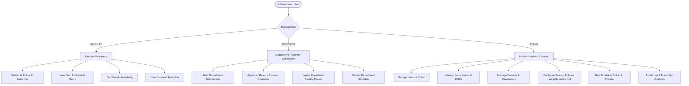
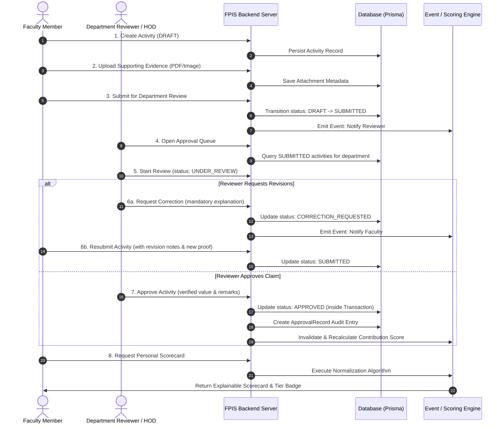
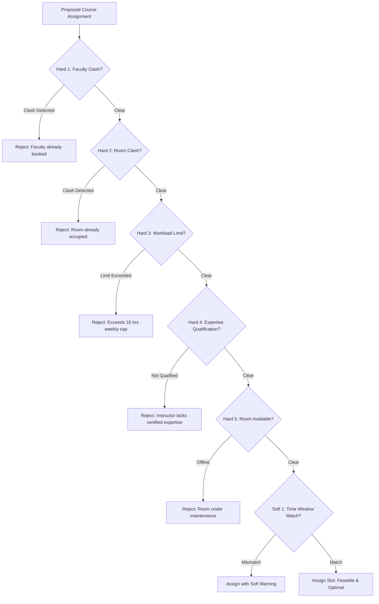
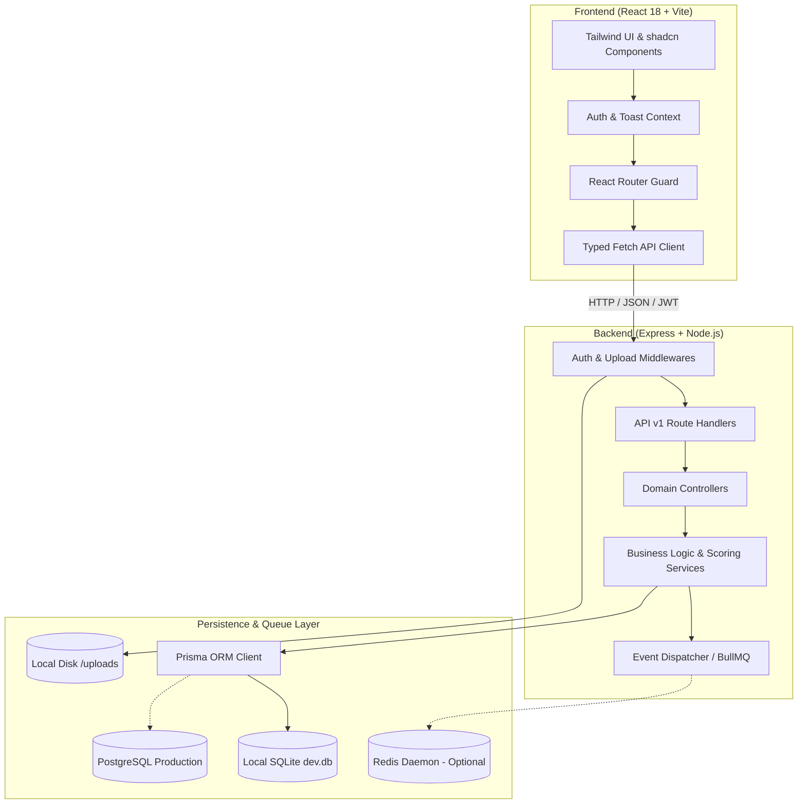
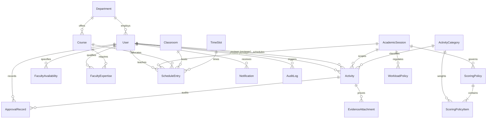

# Faculty Performance Intelligence System (FPIS)

A Comprehensive Technical & Architectural Documentation for Higher Education Academic Performance Governance, Workload Balances, Transparent Scoring, and Constraint-Satisfaction Scheduling.

---

## Table of Contents
1. [Project Title](#1-project-title)
2. [Project Overview](#2-project-overview)
3. [Problem Statement](#3-problem-statement)
4. [Problems This Project Solves](#4-problems-this-project-solves)
5. [Project Objectives](#5-project-objectives)
6. [Proposed Solution](#6-proposed-solution)
7. [Project Scope](#7-project-scope)
8. [User Roles & Access Control](#8-user-roles--access-control)
9. [Main Modules](#9-main-modules)
10. [System Workflow](#10-system-workflow)
11. [Contribution Scoring Engine](#11-contribution-scoring-engine)
12. [Scheduling Intelligence Engine](#12-scheduling-intelligence-engine)
13. [Technology Stack](#13-technology-stack)
14. [System Architecture](#14-system-architecture)
15. [Database Design & Data Models](#15-database-design--data-models)
16. [API Architecture & Route Specifications](#16-api-architecture--route-specifications)
17. [Security Architecture & Governance](#17-security-architecture--governance)
18. [Institutional Benefits](#18-institutional-benefits)
19. [Future Scope & Roadmap](#19-future-scope--roadmap)
20. [Conclusion](#20-conclusion)
21. [References & Technology Documentation](#21-references--technology-documentation)

---

## 1. Project Title

**Faculty Performance Intelligence System (FPIS)**  
*Institutional Academic Workload, Auditable Contribution Scoring, and Conflict-Free Scheduling Platform.*

---

## 2. Project Overview

The **Faculty Performance Intelligence System (FPIS)** is an enterprise-grade full-stack web application architected to modernize and centralize academic operations across higher education institutions. In modern colleges and universities, faculty responsibilities extend far beyond classroom lectures: professors and lecturers publish research, mentor students, organize faculty development programs (FDPs), serve on statutory committees (such as NBA, NAAC, and syllabus boards), handle administrative duties, and supervise extracurricular competitions.

FPIS brings order, auditability, and mathematical transparency to this complex ecosystem. It provides:
1. **A verified record repository:** Faculty members document academic activities with quantitative metrics and verifiable file evidence (certificates, registers, letters).
2. **A multi-tier approval state machine:** Department heads and designated reviewers audit submissions, request revisions with mandatory remarks, or grant verified credit.
3. **An explainable scoring engine:** Rather than using opaque AI or subjective scoring, FPIS computes an auditable **Overall Contribution Index (OCI)** based on university senate-approved mathematical weights and category caps.
4. **A smart scheduling solver:** A constraint-satisfaction scheduling engine that prevents classroom clashes, avoids double-booking faculty, enforces workload ceilings, and matches teaching expertise.
5. **Accreditation-ready reporting:** Real-time dashboards, department analytics, and one-click CSV export for NAAC/NBA accreditation audits.

---

## 3. Problem Statement

Higher education institutions face significant administrative friction because faculty performance, workload management, activity compliance, and timetable scheduling are routinely managed via **disconnected spreadsheets, email chains, paper forms, or fragmented point solutions**. 

This operational fragmentation results in:
- **Data silos:** No single institutional source of truth exists for an academic's cumulative annual contribution.
- **Subjective appraisals:** Annual appraisals frequently depend on unstructured self-reporting or subjective impressions rather than approved, verified evidence.
- **Accreditation delays:** Preparing compliance binders for accreditation bodies (e.g., NAAC, NBA, ABET) requires weeks of retroactive evidence collection, causing audit stress and human error.
- **Timetabling conflicts:** Classrooms are accidentally double-booked, faculty workload ceilings (e.g., 16 hours/week) are violated, and instructor subject qualifications are misaligned.
- **Inefficient approval loops:** Revision requests get lost in email threads, leaving faculty unaware of why their submissions stalled.

---

## 4. Problems This Project Solves

| Problem in Traditional Colleges | Solution Implemented in FPIS |
| :--- | :--- |
| **Manual Faculty Activity Tracking** | Standardized digital activity logging across 7 core academic categories with attached evidence files. |
| **Difficulty Managing Workload** | Automated weekly lecture/lab hour aggregation with visual progress meters and policy limit enforcement. |
| **Lack of Centralized Records** | Normalized PostgreSQL/SQLite relational schema binding user identities, departments, courses, and records. |
| **Time-Consuming Approvals** | Multi-state review queue (`DRAFT` ➔ `SUBMITTED` ➔ `UNDER_REVIEW` ➔ `CORRECTION_REQUESTED` ➔ `APPROVED` / `REJECTED`) with database transactions. |
| **Opaque Contribution Scoring** | 100% explainable, mathematically verified normalization formula: $\text{Score} = 100 \times \min(\text{Units}/\text{Limit}, 1)$. |
| **Scheduling Conflicts** | Automated constraint-satisfaction solver detecting room clashes, faculty double-booking, and availability preferences. |
| **Lack of Transparency** | Clear breakdown tables showing actual approved units, category upper limits, weight percentages, and qualitative tiers. |
| **Manual Report Generation** | Real-time institutional charts and instant CSV file generation with one-click export. |

---

## 5. Project Objectives

1. **Centralize Academic Contribution Records:** Create a secure, authenticated platform where faculty document all academic, research, and institutional contributions in real time.
2. **Deliver Explainable Evaluation:** Eliminate subjective evaluation bias by implementing a deterministic scoring algorithm where every point awarded is traceable to an approved record.
3. **Streamline Review Workflows:** Provide Department Heads with an organized approval queue featuring document preview, mandatory rejection explanations, and resubmission tracking.
4. **Prevent Scheduling Failures:** Engineer an automated timetable validator that enforces hard physical constraints (room availability, instructor availability, expertise matches, workload limits).
5. **Accelerate Accreditation Compliance:** Provide institutional leaders with real-time analytics and CSV exports aligned with standard accreditation parameters.

---

## 6. Proposed Solution

FPIS is designed around **four unified pillars**:

```
┌────────────────────────────────────────────────────────────────────────┐
│                   FACULTY PERFORMANCE INTELLIGENCE                     │
├─────────────────────┬────────────────────┬─────────────────────────────┤
│ 1. Activity & Proof │ 2. Workflow Audit  │ 3. Transparent Scoring      │
│ • 7 Academic Tracks │ • Queue Management │ • Senate-Defined Weights    │
│ • File Evidence     │ • Correction Loops │ • Upper Limit Normalization │
│ • Atomic CRUD       │ • Audit Trail Log  │ • Qualitative Tiers (A+ - D)│
├─────────────────────┴────────────────────┴─────────────────────────────┤
│                   4. Constraint-Satisfaction Scheduling                │
│ • Hard Clash Detection    • Expertise Match    • Workload Limit Cap    │
└────────────────────────────────────────────────────────────────────────┘
```

1. **Standardized Activity Schema:** Every faculty activity captures date ranges, quantitative units (hours, count, students, programs), detailed descriptions, and verifiable attachments.
2. **Transaction-Guarded Approval Pipeline:** Review decisions are executed inside Prisma database transactions, ensuring that review records, notifications, and status transitions occur atomically.
3. **Mathematical Normalization Policy:** Category limits prevent "metric gaming" (e.g., attending 20 workshops cannot compensate for zero teaching), while senate-weighted sums ensure balanced faculty development.
4. **Rule-Based Timetabling Solver:** Backtracking heuristic solver searches for feasible class schedules that satisfy 100% of hard institutional constraints before requiring human confirmation to publish.

---

## 7. Project Scope

### What FPIS Includes:
- Complete Role-Based Access Control for `FACULTY`, `REVIEWER`, and `ADMIN`.
- Full CRUD operations for activities across 7 institutional categories.
- Secure file upload and storage for proof documents (PDF, images, DOCX up to 10MB).
- Reviewer approval queues with feedback and revision cycles.
- Explainable Contribution Scoring Engine with policy versioning and category weight enforcement ($\sum w_i = 1.0$).
- Timetable scheduling with live conflict detection and automated schedule generation.
- Institutional dashboards tailored to each role's responsibilities.
- Audit logging of all critical system actions.
- CSV data export and printable report stylesheets.

### What FPIS Does NOT Attempt:
- **No subjective AI judgment:** FPIS does *not* use black-box artificial intelligence to grade faculty quality or make tenure decisions.
- **No student grading / LMS:** FPIS is an institutional intelligence and faculty governance tool, not a student-facing assignment submission system (e.g., Canvas, Moodle).
- **No payroll processing:** FPIS measures performance contribution and timetable load; it does not process financial payroll or tax deductions.

---

## 8. User Roles & Access Control

FPIS implements strict, multi-tiered server-side Role-Based Access Control (RBAC).



### Role Permissions Matrix

| Capability / Module | FACULTY | REVIEWER / HOD | ADMINISTRATOR |
| :--- | :---: | :---: | :---: |
| **Login / Profile Management** | Yes | Yes | Yes |
| **Document Own Activities & Upload Evidence** | Yes | Yes | Yes |
| **Edit / Delete Own Drafts** | Yes | Yes | Yes |
| **Submit Activity for Department Review** | Yes | Yes | Yes |
| **View Personal Explainable Score Breakdown** | Yes | Yes | Yes |
| **Manage Personal Availability Preferences** | Yes | Yes | Yes |
| **Access Department Review Queue** | No | Yes (Assigned Dept) | Yes (All Depts) |
| **Approve / Reject / Request Revisions** | No | Yes (Assigned Dept) | Yes (All Depts) |
| **Inspect All Department Faculty Scores** | No | Yes (Assigned Dept) | Yes (All Depts) |
| **Manage Users & Reset Passwords** | No | No | Yes |
| **Manage Departments, Courses & Classrooms** | No | No | Yes |
| **Configure Scoring Weights & Policy Limits** | No | No | Yes |
| **Generate & Commit Institutional Timetable** | No | Yes (View/Suggest) | Yes (Full Commit) |
| **Access System-Wide Audit Logs** | No | No | Yes |
| **Export Institutional CSV Reports** | Self Only | Department Only | University-Wide |

---

## 9. Main Modules

### 9.1 Authentication and Authorization
- Secure JWT (JSON Web Token) token-based authentication.
- Cryptographic password hashing using `bcryptjs` with salt rounds.
- Authorization middleware (`authenticateToken`, `requireRoles`, `requireDepartmentAccess`).
- Department data isolation ensuring department heads cannot tamper with other faculties.

### 9.2 Faculty Profile Management
- Tracks employee ID, institutional email, designation, academic department, contact phone, and biography.
- Secure password change flow verifying previous password hash.

### 9.3 Faculty Activity Management
Complete CRUD functionality supporting 7 predefined categories:
1. **Teaching Workload:** Lecture, tutorial, and laboratory hours.
2. **Faculty Development Programs (FDP):** Short-term training programs, AICTE/ATAL workshops, certifications.
3. **Student Mentoring:** Capstone project guidance and undergraduate counseling batches.
4. **Extra Academic Sessions:** Remedial coaching for weak students and guest lecture series.
5. **Committee Responsibilities:** NBA/NAAC accreditation committees, syllabus revision boards, exam squads.
6. **Administrative Responsibilities:** Lab in-charge, timetable coordinator, HOD assistant.
7. **Extracurricular Engagement:** Hackathons, student clubs, sports, and cultural festivals.

### 9.4 Evidence Upload
- Multi-format file uploader accepting PDF documents, JPEG/PNG images, and Word documents (`.doc`, `.docx`).
- Enforces strict 10MB file size limits and MIME-type validation.
- Files stored with sanitized timestamps in `server/uploads/` with download/preview endpoints.

### 9.5 Approval Workflow
- Formal finite state machine transitions:
  - `DRAFT`: Editable by faculty.
  - `SUBMITTED`: Locked; routed to department reviewer queue.
  - `UNDER_REVIEW`: Reviewer commenced active audit.
  - `CORRECTION_REQUESTED`: Reviewer returned with mandatory revision comments.
  - `APPROVED`: Reviewer verified credits; contributes to OCI score.
  - `REJECTED`: Reviewer denied claim with mandatory rationale; 0 credits granted.
- Maintains complete historical `ApprovalRecord` audit trails.

### 9.6 Contribution Scoring Engine
- Computes deterministic, auditable scores per category and overall index.
- Senate policy versioning with active flag.
- Enforces weight sum rule ($\sum w_i = 1.0$) upon policy save.

### 9.7 Faculty Workload Management
- Workload policy tracks weekly teaching hours against an institutional cap (e.g., 16 hours/week).
- Visual progress bars display workload distribution.

### 9.8 Smart Scheduling
- Constraint-satisfaction timetable engine allocating courses, instructors, classrooms, and time slots.
- Live interactive Conflict Detector explaining rejection rationales.
- Automated Feasible Schedule Generator with human confirmation modal.

### 9.9 Dashboard and Analytics
- Role-customized views with live database metrics.
- Recharts bar graphs and progress indicators.
- Quick action shortcuts.

### 9.10 Reports Module
- Tabbed reports for Faculty Contribution, Department Analytics, and Activity Participation.
- Real CSV export generating downloadable `.csv` streams.
- Print-optimized stylesheets.

### 9.11 Notifications
- Internal event-driven notification center.
- Unread count badges and click-to-navigate action links.
- "Mark all as read" capability.

### 9.12 Audit Logs
- Immutable ledger recording operator, action code, entity type, entity ID, payload details, and timestamps.
- Filterable by entity type and action keywords.

### 9.13 Administration
- Central governance console for departments, courses, classrooms, timeslots, and scoring policies.

---

## 10. System Workflow



---

## 11. Contribution Scoring Engine

### 11.1 The Mathematical Model
FPIS strictly adheres to an explainable mathematical formula approved by academic governing bodies.

#### Step 1: Category Normalization
For any activity category $i$ with actual verified contribution $A_i$ and policy ceiling $L_i$:
$$\text{Normalized Score}_i = 100 \times \min\left(\frac{A_i}{L_i}, 1.0\right)$$

*Where:*
- $A_i$: The sum of `approvedValue` units across all `APPROVED` activities in category $i$ during the session. Unapproved, draft, or pending activities contribute $0$.
- $L_i$: The category upper limit (e.g., 120 teaching hours, 3 FDP programs, 15 mentored students).
- If $A_i \ge L_i$, the score is capped at $100.0$ to prevent over-indexing in a single category.

#### Step 2: Overall Contribution Index (OCI)
$$\text{OCI} = \sum_{i=1}^{n} \left( W_i \times \text{Normalized Score}_i \right)$$

*Where:*
- $W_i$: The senate-approved policy weight for category $i$ (e.g., $0.35$ for Teaching Workload).
- Constraint: $\sum_{i=1}^{n} W_i = 1.000$ (enforced on policy updates).
- Maximum possible OCI is $100.00$ points.

### 11.2 Default Institutional Scoring Policy Baseline

| Category Code | Category Name | Default Upper Limit ($L_i$) | Senate Weight ($W_i$) | Max Weighted Points |
| :--- | :--- | :---: | :---: | :---: |
| `TEACHING` | Teaching Workload | 120 Hours | **0.35** (35%) | 35.0 pts |
| `FDP` | Faculty Development Programs | 3 Programs | **0.15** (15%) | 15.0 pts |
| `MENTORING` | Student Mentoring | 15 Students | **0.10** (10%) | 10.0 pts |
| `EXTRA_ACADEMIC` | Extra Academic Sessions | 20 Hours | **0.10** (10%) | 10.0 pts |
| `COMMITTEE` | Committee Responsibilities | 3 Committees | **0.10** (10%) | 10.0 pts |
| `ADMINISTRATIVE` | Administrative Responsibilities | 2 Roles | **0.10** (10%) | 10.0 pts |
| `EXTRACURRICULAR` | Extracurricular Engagement | 4 Events | **0.10** (10%) | 10.0 pts |
| **TOTAL** | — | — | **1.00 (100%)** | **100.0 pts** |

### 11.3 Qualitative Performance Tiers

| Tier Code | Qualitative Designation | OCI Range | Academic Interpretation |
| :--- | :--- | :---: | :--- |
| `EXEMPLARY` | Tier A+ | **85.0 – 100.0** | Surpasses institutional quality expectations across all dimensions. |
| `COMMENDABLE` | Tier A | **70.0 – 84.9** | Consistently meets high benchmarks with strong multi-category output. |
| `SATISFACTORY` | Tier B | **55.0 – 69.9** | Meets baseline university requirements; areas for growth identified. |
| `DEVELOPING` | Tier C | **40.0 – 54.9** | Baseline threshold; requires department mentoring and support. |
| `NEEDS_IMPROVEMENT`| Tier D | **< 40.0** | Substantial gaps in approved academic activity documentation. |

---

## 12. Scheduling Intelligence Engine

### 12.1 Constraint Satisfaction Model
The smart scheduling system solves the academic timetable problem by treating course allocations as a Constraint Satisfaction Problem (CSP).



### 12.2 Hard Constraints (Strict Non-Negotiable Rules)
1. **Zero Faculty Clashes:** An instructor cannot be assigned to two classes or laboratories in the same period.
2. **Zero Room Clashes:** A classroom or laboratory venue cannot host two different courses in the same period.
3. **Weekly Workload Ceiling:** Teaching assignments cannot cause an instructor's weekly hours to exceed the `WorkloadPolicy.maxTeachingHoursPerWeek` (standard: 16.0 hours).
4. **Subject Expertise Qualification:** An instructor must possess registered `PRIMARY` or `SECONDARY` competency in `FacultyExpertise` for the target course code.
5. **Classroom Availability:** Venues marked `isAvailable: false` are excluded from allocation.

### 12.3 Soft Preferences (Optimization Heuristics)
- **Time Window Preference:** Honors the instructor's preference (`MORNING` vs `AFTERNOON`) configured in `FacultyAvailability`.
- **Facility Type Matching:** Laboratory courses (`labHoursPerWeek > 0`) prioritize `COMPUTER_LAB` venues, while theory lectures select `LECTURE_HALL` venues.

### 12.4 Conflict Detection vs. Auto-Generator
- **Conflict Detector:** An on-demand testing endpoint (`POST /api/v1/scheduling/check-conflicts`) validating user-selected slot proposals against active entries and returning specific violation descriptions.
- **Automated Feasible Generator:** A backtracking solver (`POST /api/v1/scheduling/generate`) scanning unallocated courses, matching qualified instructors, finding mutually free time windows, and allocating classrooms without collisions.
- **Human Confirmation:** Generated plans remain in preview until an administrator clicks **"Confirm & Publish Schedule"**, calling `POST /api/v1/scheduling/commit`.

---

## 13. Technology Stack

| Technology | Layer | Purpose in FPIS | Justification & Architectural Role |
| :--- | :--- | :--- | :--- |
| **React 18** | Frontend UI | Component Architecture | Provides reactive state management, component reusability, and efficient DOM reconciliation. |
| **TypeScript** | Full Stack | Type Safety | Enforces end-to-end contracts between Prisma schemas, Express REST payloads, and React components. |
| **Vite 5** | Frontend Tooling | Build & Dev Server | Ultra-fast Hot Module Replacement (HMR) and optimized Rollup production bundling. |
| **Tailwind CSS** | Styling | Enterprise Styling | Utility-first, responsive CSS architecture delivering an institutional aesthetic without bulky UI libraries. |
| **shadcn/ui Design Pattern** | UI Components | Component Primitives | Accessible, composable dialogs, buttons, badges, tables, and dropdown primitives. |
| **Lucide Icons** | Frontend | Iconography | High-legibility, scalable SVG icon set for academic and operational workflows. |
| **React Router v6** | Client Routing | SPA Navigation | Protected route guards, layout nesting, and role-based redirection. |
| **TanStack Query v5** | State Management | Server State Caching | Handles asynchronous data fetching, loading states, and cache invalidation. |
| **React Hook Form & Zod** | Form Validation | Client-side Validation | Declarative schema validation ensuring input conformity before network requests. |
| **Recharts** | Data Visualization | Institutional Charts | Responsive SVG bar charts and performance distribution graphs. |
| **Node.js (v18+)** | Backend Runtime | JavaScript Execution | Non-blocking, asynchronous I/O runtime powering the REST API. |
| **Express 4** | Backend Framework| Web Routing | Lightweight, battle-tested HTTP server handling middleware, controllers, and JSON serialization. |
| **Prisma ORM (v5.22)** | Database Layer | Object-Relational Mapping| Provides type-safe queries, migration automation, relational foreign key handling, and atomic transactions. |
| **PostgreSQL & SQLite** | Database Engine | Data Persistence | SQLite configured for zero-dependency local execution; PostgreSQL supported for production environments. |
| **BullMQ & IORedis** | Event Processing | Background Workers | Distributed event queue handling audit logging and notification dispatch with in-process fallback. |
| **Bcryptjs** | Security | Password Hashing | One-way salted password hashing securing user credentials against credential dumps. |
| **JSONWebToken (JWT)** | Security | Stateless Auth | Compact, signed session tokens transmitting identity and role claims across requests. |
| **Multer** | File Handling | Evidence Storage | Multipart/form-data handler streaming uploaded proof documents to local storage. |
| **Vitest** | Testing | Test Runner | Next-generation unit and integration test runner executing backend and frontend suites. |

---

## 14. System Architecture



### Data Flow Lifecycle:
1. **Client Request:** The user interacts with a React view (e.g., submitting an activity). React Hook Form and Zod validate fields locally.
2. **Secure Transport:** The client API service attaches the JWT bearer token and sends an HTTP `POST` request to `/api/v1/activities`.
3. **Middleware Interception:** Express passes the request through `authenticateToken` to decode the JWT, verify user status, and reject expired sessions.
4. **Service & Transaction:** The controller delegates to `activityService.createActivity`, which invokes `prisma.activity.create` within the database.
5. **Event Emission:** An event is dispatched to `eventService` to create an immutable `AuditLog` entry and deliver user notifications.
6. **State Refresh:** The frontend receives a JSON response, triggers a toast alert, and refreshes the dashboard view.

---

## 15. Database Design & Data Models

The relational schema is defined in `server/prisma/schema.prisma`.



### Primary Entity Descriptions

1. **User:** Central identity table containing `email`, `passwordHash`, `firstName`, `lastName`, `employeeId` (unique), `role` (`FACULTY`, `REVIEWER`, `ADMIN`), `designation`, and `status`.
2. **Department:** Academic units (`code`, `name`, `description`, `hodId`).
3. **AcademicSession:** Academic terms (`code`, `name`, `startDate`, `endDate`, `isCurrent`).
4. **ActivityCategory:** Predefined institutional activity categories with units and default weights.
5. **ScoringPolicy & ScoringPolicyItem:** Holds the senate policy version and category weightings ($W_i$) and upper limits ($L_i$).
6. **WorkloadPolicy:** Sets weekly teaching ceilings (e.g., max 16 hours) and minimums.
7. **Activity:** The core record table storing quantitative units, dates, statuses (`DRAFT`, `SUBMITTED`, `UNDER_REVIEW`, `CORRECTION_REQUESTED`, `APPROVED`, `REJECTED`), approved units, and reviewer feedback.
8. **EvidenceAttachment:** Files linked to activities with file paths, sizes, and MIME types.
9. **ApprovalRecord:** Immutable historical log tracking status changes, comments, and reviewer IDs.
10. **FacultyAvailability:** Days of week preferences (`MORNING`, `AFTERNOON`, `ANY`, `UNAVAILABLE`) and daily caps.
11. **Course:** Curriculum registry (`code`, `name`, `credits`, `lectureHoursPerWeek`, `labHoursPerWeek`).
12. **FacultyExpertise:** Many-to-many relationship connecting faculty to qualified courses (`PRIMARY`, `SECONDARY`).
13. **Classroom:** Physical venues (`roomNumber`, `building`, `capacity`, `type`, `isAvailable`).
14. **TimeSlot:** Periods mapping days of the week, start times, and end times.
15. **ScheduleEntry:** Published timetable assignments joining Session, Course, Faculty, Classroom, and TimeSlot.
16. **Notification:** User-specific alert inbox with read/unread flags and target links.
17. **AuditLog:** System event ledger for security auditing.

---

## 16. API Architecture & Route Specifications

All endpoints are versioned under `/api/v1/` and return consistent JSON structures:
```json
{ "success": true, "data": { ... } }
```

### API Endpoint Directory

#### Authentication & Profile (`/api/v1/auth`)
- `POST /login`: Authenticates email and password; returns JWT token and user profile.
- `GET /me`: Returns currently authenticated user context and permissions.
- `PUT /profile`: Updates contact phone and academic biography.
- `POST /change-password`: Verifies current password and applies a new bcrypt hash.

#### Activities Management (`/api/v1/activities`)
- `GET /categories`: Lists all institutional activity categories.
- `GET /metrics/faculty`: Returns dashboard metrics (total submitted, approved, pending, correction counts).
- `GET /`: Lists activities with pagination and category/status/search filters.
- `POST /`: Creates a new activity in `DRAFT` status.
- `GET /:id`: Retrieves full activity details, evidence attachments, and approval records.
- `PUT /:id`: Updates activity metadata (permitted only in `DRAFT` or `CORRECTION_REQUESTED` status).
- `DELETE /:id`: Deletes activity and unlinks physical evidence (only in `DRAFT` or `REJECTED` status).
- `POST /:id/submit`: Transitions status from `DRAFT` to `SUBMITTED`.
- `POST /:id/resubmit`: Submits revised activity with correction notes.
- `POST /:id/evidence`: Attaches an uploaded file document via Multer.
- `DELETE /evidence/:evidenceId`: Removes an attached evidence file from disk and database.

#### Approval Workflows (`/api/v1/approvals` - Restricted to `REVIEWER`, `ADMIN`)
- `GET /queue`: Returns submitted activities filtered by reviewer department.
- `GET /stats`: Returns pending counters and department faculty submission summaries.
- `POST /:id/start-review`: Marks submission as `UNDER_REVIEW`.
- `POST /:id/approve`: Grants verified units and records approval remarks.
- `POST /:id/reject`: Rejects submission with mandatory written rationale.
- `POST /:id/request-correction`: Reverts submission with mandatory correction instructions.

#### Contribution Scoring (`/api/v1/scoring`)
- `GET /my-score`: Calculates logged-in faculty member's explainable scorecard.
- `GET /faculty/:facultyId`: Calculates scorecard for specified faculty member.
- `GET /department/:departmentId`: Computes aggregate score summaries for a department.
- `GET /policy/active`: Retrieves current scoring policy items, weights, and upper limits.
- `PUT /policy/:id`: Admin-only update enforcing category weights sum to 1.0.

#### Scheduling & Timetables (`/api/v1/scheduling`)
- `GET /timetable`: Retrieves master or faculty-specific timetable entries.
- `POST /check-conflicts`: Evaluates an assignment against hard and soft constraints.
- `GET /availability`: Retrieves faculty weekly availability preferences.
- `PUT /availability`: Saves weekly availability preferences.
- `POST /generate`: Runs constraint satisfaction solver to propose conflict-free allocations.
- `POST /commit`: Finalizes and persists verified timetable entries.
- `DELETE /entries/:id`: Removes a scheduled entry.

#### Administration (`/api/v1/admin` - Restricted to `ADMIN`)
- `GET /stats`: University-wide overview counters.
- `GET /users`, `POST /users`, `PUT /users/:id`: User account administration.
- `POST /users/:id/reset-password`: Administrator-initiated credential reset.
- `GET /departments`, `POST /departments`, `PUT /departments/:id`: Department configuration.
- `GET /courses`, `POST /courses`, `POST /courses/assign-expertise`: Curriculum management.
- `GET /classrooms`, `POST /classrooms`, `PUT /classrooms/:id`: Venue directory.
- `GET /time-slots`: Period definitions.
- `GET /academic-sessions`, `POST /academic-sessions`: Term lifecycle management.
- `GET /audit-logs`: System event log inspection.

#### Reporting & Analytics (`/api/v1/reports`)
- `GET /faculty-contribution`: Faculty score report with tier mappings.
- `GET /department-analytics`: Department comparative analytics.
- `GET /activity-participation`: Activity distribution metrics.
- `GET /export/csv`: Streams pre-formatted `.csv` download.

#### Notifications (`/api/v1/notifications`)
- `GET /`: Lists user notification inbox and unread count.
- `PUT /:id/read`: Marks individual notification as read.
- `PUT /read-all`: Clears all unread notifications.

---

## 17. Security Architecture & Governance

```
┌────────────────────────────────────────────────────────┐
│                   SECURITY BOUNDARIES                  │
├────────────────────────────────────────────────────────┤
│ 1. Transport Layer: Strict HTTP Header & Bearer Tokens │
│ 2. Cryptography: Bcrypt (Salt Rounds: 10) Passwords   │
│ 3. Authorization: Role-Based + Department Isolation    │
│ 4. Validation: Zod Schemas at API Boundary             │
│ 5. Auditability: Immutable System Audit Logs           │
└────────────────────────────────────────────────────────┘
```

1. **Password Security:** Passwords are never stored in plaintext. Passwords are encrypted using one-way bcrypt hashing with salt rounds. Responses strip `passwordHash` before returning user payloads.
2. **Department Isolation:** Department Head reviewers are restricted to auditing faculty within their assigned department. The middleware `requireDepartmentAccess` blocks cross-department unauthorized manipulation.
3. **Input Sanitization & Validation:** All incoming request bodies are validated using Zod schemas (`createActivitySchema`, `policyUpdateSchema`, `checkConflictSchema`). Invalid payloads are rejected with descriptive `400 Validation Error` responses.
4. **File Upload Hardening:** Multer restricts uploads to validated file extensions (`.pdf`, `.jpg`, `.png`, `.doc`, `.docx`) and enforces a 10MB file limit to prevent denial-of-service storage exhaustion.
5. **Database Transaction Guarding:** Critical state transitions (such as activity approvals, schedule commitments, and policy weight updates) execute within `prisma.$transaction()`, ensuring rollback upon partial failure.
6. **Immutable Audit Trails:** System modifications trigger structured `AuditLog` records storing user ID, action code, entity ID, and client IP address.

---

## 18. Institutional Benefits

### For Faculty Members
- **Zero Evidence Loss:** Centralized document archive ensures proof of workshops, student mentoring, and publications are permanently recorded.
- **Explainable Appraisals:** Eliminates guesswork around performance evaluations; faculty see their exact normalized category scores and points in real time.
- **Fair Workload Protection:** Prevents over-scheduling beyond institutional weekly limits.

### For Department Heads & Reviewers
- **Structured Review Queue:** Replaces email attachments with a clean queue where attached proof can be inspected with one click.
- **Constructive Revision Cycles:** Mandatory explanations ensure faculty receive actionable feedback when corrections are needed.
- **Department Oversight:** Instant visibility into staff performance distribution and upcoming accreditation readiness.

### For College Administrators & Deans
- **Policy Control:** Dynamic adjustment of category weights (e.g., increasing research FDP weight to 20%) immediately updates calculations across the institution.
- **Accreditation Readiness:** NAAC and NBA compliance tables can be exported to CSV within seconds rather than requiring weeks of manual data collation.
- **Timetabling Feasibility:** Automated schedule generator eliminates venue collisions and impossible instructor timetables.

---

## 19. Future Scope & Roadmap

While FPIS is a fully functioning application, future iterations could expand its capabilities:
1. **Biometric Attendance Integration:** Connecting laboratory and classroom RFID/biometric readers directly to verify scheduled teaching hours automatically.
2. **Research Citation Indexing:** Automated integration with scholarly APIs (e.g., OpenAlex, Scopus, Google Scholar) to auto-verify research publications and citation counts.
3. **Student Feedback API Integration:** Ingesting end-of-semester student survey feedback as an optional, approved metric item within the teaching category.
4. **Granular Calendar Synchronization:** Generating `.ics` calendar feeds allowing faculty to sync their FPIS timetables with Google Calendar or Microsoft Outlook.
5. **Single Sign-On (SSO):** Incorporating SAML 2.0 / OAuth2 / LDAP providers for campus-wide directory integration.

---

## 20. Conclusion

The **Faculty Performance Intelligence System (FPIS)** demonstrates how modern full-stack web engineering can solve long-standing operational inefficiencies in academic institutions. By replacing manual, fragmented workflows with typed database models, structured approval state machines, explainable contribution algorithms, and constraint-based scheduling, FPIS establishes an auditable standard for faculty performance management. The application ensures academic governance remains transparent, equitable, and accreditation-ready.

---

## 21. References & Technology Documentation

- **React Documentation:** https://react.dev/
- **TypeScript Official Handbook:** https://www.typescriptlang.org/docs/
- **Prisma ORM Reference & Schema Guides:** https://www.prisma.io/docs/
- **Express.js API Reference:** https://expressjs.com/
- **Tailwind CSS Documentation:** https://tailwindcss.com/docs
- **Vite Build Tool:** https://vitejs.dev/guide/
- **FullCalendar Documentation:** https://fullcalendar.io/docs
- **Recharts Library Documentation:** https://recharts.org/
- **Zod Validation Documentation:** https://zod.dev/
- **BullMQ Background Event Processing:** https://docs.bullmq.io/
- **Vitest Unit & Integration Testing:** https://vitest.dev/
